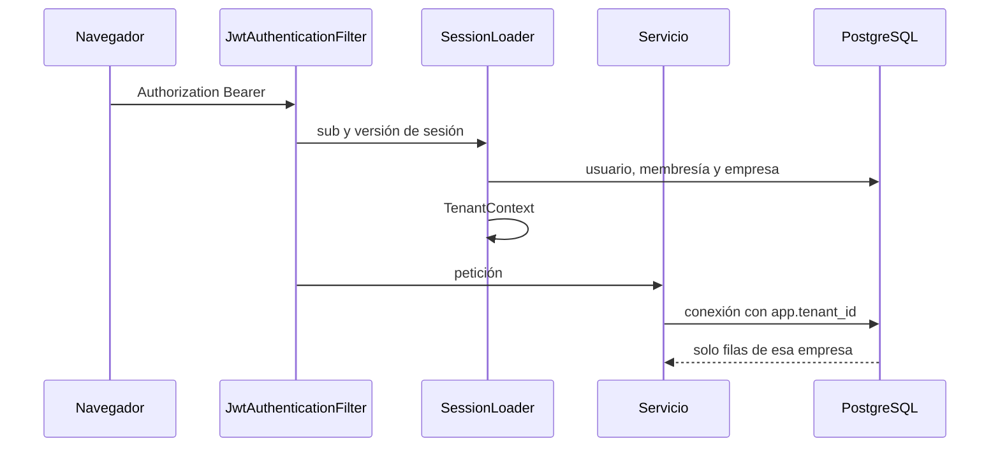

# Arquitectura de Neiver Labs

Este documento explica las decisiones de la primera versión y el sitio que queda reservado para OpenAI, Ollama y n8n. La aplicación que acompaña a este texto solo implementa la fase 1.

## Qué se pide y qué entra ahora

Neiver Labs tiene que ser una plataforma multiempresa: cada pyme ve sus usuarios, sus automatizaciones, su historial y su consumo, y no los de otra. El administrador general ve todas las empresas. El motor de flujos será n8n y la inteligencia artificial saldrá de un proveedor intercambiable, empezando por OpenAI y dejando sitio a un modelo local.

Generar todo eso de una vez dejaría controladores que llaman a un modelo falso y paneles con ceros presentados como consumo real. La fase 1 construye la parte de la que depende el resto:

- empresas y usuarios;
- sesión con renovación;
- tres roles;
- aislamiento por empresa en el servicio y en PostgreSQL;
- auditoría de las operaciones de identidad;
- una interfaz para administrar eso.

El presupuesto mensual de IA se puede guardar en la ficha de la empresa. El campo `aiBudgetEnforced` de la respuesta vale siempre `false`. No hay llamadas que bloquear.

## Decisiones

**Un esquema compartido, con `company_id`.** Cada empresa no tiene su propia base. Para el volumen previsto (pymes de una comarca, decenas o cientos de clientes) un esquema por empresa multiplica migraciones y copias de seguridad sin ganar un aislamiento que PostgreSQL no pueda dar con políticas de fila. El coste es la disciplina: toda consulta de negocio tiene que saber a qué empresa pertenece.

**La autorización manda; Row Level Security es la red.** Un servicio comprueba el rol y la empresa antes de tocar datos. Además, el pool de conexiones fija variables de sesión (`app.tenant_id`, `app.user_id`, `app.bypass_rls`, `app.login_lookup`, `app.token_lookup`) y las políticas de PostgreSQL rechazan filas de otra empresa. Si un repositorio olvida el `WHERE`, la base no devuelve la fila. RLS no sustituye la comprobación de rol: un administrador y un usuario de la misma empresa ven las mismas filas; quién puede suspender o crear usuarios lo decide el servicio.

**El rol de la aplicación no puede saltarse RLS.** `neiver_app` se crea `NOSUPERUSER` y sin `BYPASSRLS`. Al arrancar, `DatabaseRoleGuard` lee `pg_roles` y aborta si el rol conectado es superusuario o tiene `BYPASSRLS`. Flyway usa otro rol, `neiver_migrator`, dueño de las tablas. La aplicación no se conecta con ese rol.

**Las variables de sesión se fijan al sacar la conexión del pool.** `set_config(..., true)` muere al terminar la sentencia cuando la conexión está en autocommit, y Hikari comprueba la conexión así. Por eso `RlsSettings` usa `set_config(..., false)`. Si el contexto cambia dentro de una transacción ya abierta, hay que llamar a `RlsSession.sync()`. La regla práctica es fijar `TenantContext` antes de abrir la transacción.

**Un usuario, una empresa.** El correo es único en toda la plataforma y `memberships.user_id` es único. Un administrador general tiene `company_id` nulo. Cuando haga falta que la misma persona entre en dos empresas, se revisará esta restricción; no se anticipa con una unión de muchos a muchos que la interfaz no sabe explicar.

**El JWT de acceso no es la fuente del rol.** Dura 15 minutos y solo lleva el identificador del usuario y la versión de sesión. En cada petición, `SessionLoader` vuelve a leer el usuario, su membresía y el estado de la empresa. Suspender una empresa o cambiar una clave invalida el acceso aunque el token no haya caducado, porque sube `session_version`. La suspensión se comprueba antes que la versión, para devolver `COMPANY_SUSPENDED` y no un token inválido genérico.

**La renovación no viaja en JSON.** Son 32 bytes aleatorios. En la base se guarda su SHA-256. El navegador la recibe en la cookie `neiver_refresh`, `HttpOnly`, `SameSite=Strict`, limitada a `/api/v1/auth`. Cada renovación rota el valor. Si reaparece un token ya sustituido, se revoca toda la familia y se sube la versión de sesión. Cerrar sesión sube la versión y revoca todas las renovaciones de esa cuenta: en esta versión el cierre es global, no por dispositivo. Un acceso nuevo no cierra los demás.

**Claves con BCrypt y un prefijo.** `DelegatingPasswordEncoder` guarda `{bcrypt}`. El coste es 12 en desarrollo y producción, y 4 en las pruebas. La columna admite 255 caracteres para poder pasar a Argon2 sin migración. BCrypt ignora lo que pase de 72 bytes: la política rechaza esas claves en vez de guardar una distinta de la que la persona cree haber elegido. Hace falta una letra, un número, entre 12 y 200 caracteres, y que no coincida con el correo.

**El límite de intentos vive en memoria.** Diez intentos de acceso por minuto e IP, y cinco fallos de clave antes de bloquear la cuenta 15 minutos. Sirve para un solo proceso. Cuando haya más de una instancia hará falta un contador compartido. Un correo inexistente tarda lo mismo que uno existente: se calcula un BCrypt de relleno y el mensaje es el mismo.

**No hay borrado físico de empresas ni de usuarios.** Se suspende o se desactiva. Las políticas RLS no tienen `DELETE`. El último administrador activo de una empresa no se puede desactivar.

**Hibernate no crea el esquema.** `ddl-auto` es `validate`. El esquema lo crea Flyway. `open-in-view` está apagado: una vista no dispara consultas perezosas fuera de la transacción.

**La API responde `application/problem+json`.** Cada error lleva un `code` estable (`INVALID_CREDENTIALS`, `LAST_ADMIN`, `COMPANY_SUSPENDED`, …). El texto está en español. Los fallos inesperados no devuelven la excepción.

**Los documentos no salen de la plataforma en esta fase porque no hay documentos.** Cuando exista el procesamiento, el envío a un modelo externo exigirá un consentimiento explícito de esa empresa. El diseño del proveedor de IA está más abajo; el código del proveedor no existe todavía.

## Cómo viaja una petición

El administrador general entra con `app.bypass_rls=on`. Eso no lo decide el token: lo decide la membresía leída de la base. Un usuario de empresa nunca activa ese flag.

Hay dos búsquedas anteriores a conocer el usuario. El acceso busca por correo (`app.login_lookup`) y la renovación busca por hash (`app.token_lookup`). Esas políticas solo permiten localizar la fila; el resto de la operación ya ocurre con el usuario identificado. Sin una de esas dos ventanas, el acceso no podría encontrar la cuenta, porque todavía no hay `app.user_id`.

## Modelo que existe

| Tabla | Para qué | Aislamiento |
| --- | --- | --- |
| `companies` | Ficha legal, estado, plan y presupuesto de IA sin aplicar | Un tenant solo ve su fila. El bypass ve todas. |
| `users` | Credencial y estado de la cuenta | Visible para el propio usuario, para su empresa y durante la búsqueda de acceso |
| `memberships` | Rol y empresa. Una fila por usuario | La empresa ve las suyas. El bypass ve todas. |
| `refresh_tokens` | Hash de la renovación y familia de rotación | El usuario ve las suyas. La búsqueda por hash solo ocurre con `app.token_lookup`. |
| `audit_logs` | Quién hizo qué, cuándo y desde qué IP | La empresa ve las suyas. Un acceso fallido puede no tener empresa y solo se inserta durante la búsqueda de acceso. |

`monthly_ai_budget_eur` puede ser nulo: significa que no hay límite configurado. Un valor presente queda guardado para la fase 2 y no se consulta al autorizar nada, porque no hay operaciones de IA.

El NIF, NIE o CIF se valida con el dígito de control. No se consulta el censo.

## Modelo que todavía no se migra

Estas tablas se crearán con el código que las usa. Crearlas ahora dejaría datos sin políticas ni servicios.

**Fase 2, consumo.** `ai_usage` (empresa, usuario, automatización opcional, proveedor, modelo, tokens de entrada y salida, coste estimado, estado, fecha) y `ai_model_pricing` (proveedor, modelo, precio de entrada y de salida por millón de tokens, vigencia). El precio se lee de esa tabla. No hay un precio único ni un precio escrito en el código. `ai_provider_configuration` dirá, por empresa y por tipo de tarea, qué proveedor usar. La clave del proveedor se guardará cifrada, no en claro.

**Fase 3, n8n.** `automation` (nombre, descripción, empresa, tipo, estado, identificador del workflow, alta y última ejecución) y `automation_execution` (estado, error, resultado, fechas). El cliente no envía un identificador arbitrario de n8n: elige una automatización de su empresa y el backend traduce eso al workflow registrado. El webhook entrante tendrá un secreto por automatización y rechazará firmas que no cuadren.

**Fase 5, documentos y pedidos.** `document` (empresa, tipo, almacenamiento, consentimiento de tratamiento externo, resultado extraído), el índice de la base documental de esa empresa y las tablas de pedidos e incidencias. Cada empresa tiene su espacio. El asistente solo podrá responder con datos devueltos por servicios autorizados de esa empresa.

**Integraciones, avisos y suscripción.** `integration` guardará credenciales cifradas de servicios externos. `notification` será el aviso interno. `subscription` no es un cobro: de momento el plan es una etiqueta (`plan_label`) que escribe el administrador general. El cobro no forma parte de estas fases.

Todas esas tablas llevarán `company_id` salvo la configuración global de precios, y tendrán `ENABLE` y `FORCE ROW LEVEL SECURITY` antes de que el primer servicio las use.

## Proveedor de IA, cuando exista

La fase 2 añadirá una interfaz `AIProvider` con una implementación `OpenAIProvider`. `OllamaProvider` vendrá después, sin cambiar los casos de uso. La selección será por empresa, por tipo de tarea o por política de privacidad, leyendo `ai_provider_configuration`. La clave de OpenAI solo la leerá el backend. Hoy no hay clase que llame a un modelo: no hay una respuesta simulada que alguien pueda confundir con un servicio terminado.

## Módulos de la fase 1

| Módulo | Responsabilidad |
| --- | --- |
| `tenant` | Contexto por hilo, variables de sesión y rechazo de un rol que ignora RLS |
| `identity` | Acceso, renovación, claves, usuarios y roles |
| `company` | Alta, ficha, suspensión y datos de contacto |
| `audit` | Registro y consulta de la actividad |
| `dashboard` | Conteos reales para los dos resúmenes |
| `config` | Seguridad HTTP, CORS, fuentes de datos y arranque de producción |
| `frontend` | Acceso, cambio de clave, administración y portal de empresa |

El detalle de cada uno, y cómo probarlo, está en [fase-1/modulos.md](fase-1/modulos.md).

## Riesgos que siguen abiertos

1. **Una inyección SQL que ejecute `set_config` se salta RLS.** Las políticas no son un sustituto de las consultas parametrizadas. JPA parametriza; cualquier SQL nativo nuevo tiene que hacerlo también.
2. **El límite de intentos no se comparte entre procesos.** Con una sola instancia basta. Con varias, un atacante reparte los intentos.
3. **Cerrar sesión cierra todas las sesiones de la cuenta.** Es lo correcto mientras no haya una pantalla de dispositivos. Hay que decirlo al cliente.
4. **BCrypt y las claves largas.** El límite de 72 bytes está aplicado. Si se pasa a Argon2, el prefijo `{bcrypt}` permite convivir con las claves antiguas.
5. **No hay correo.** Una clave temporal mal entregada es un problema operativo, no un fallo de la API. La interfaz lo dice.
6. **El perfil `dev` trae secreto y clave conocidos.** `ProductionGuard` impide usarlos con el perfil `prod`. No hay que arrancar el perfil `dev` en un servidor expuesto.
7. **La retención de auditoría no está automatizada.** Los accesos fallidos guardan correo e IP. El criterio está en [privacidad.md](privacidad.md); el borrado programado no.
8. **RLS no distingue roles dentro de la empresa.** Un usuario y un administrador ven las mismas filas de momento, porque los datos de la fase 1 son la propia cuenta. En cuanto haya documentos, las políticas tendrán que conocer el permiso, o el servicio tendrá que filtrar antes.

## Fases siguientes

| Fase | Se añade | No se adelanta |
| --- | --- | --- |
| 2 | `AIProvider`, OpenAI, precios por modelo, registro de tokens y bloqueo al llegar al presupuesto | Ollama y la interfaz de chat |
| Hostelería-1 | Mesas, reservas, ocupación del día, aviso WhatsApp Cloud API | Widget público de reservas, TPV, plantillas WhatsApp en UI |
| 3 | Automatizaciones, ejecuciones y webhooks firmados | Los tres procesos de negocio |
| 4 | Gráficos con esas cifras reales | Conteos inventados |
| 5 | Facturas y albaranes, asistente con datos de la empresa, pedidos | Envío externo sin consentimiento |
| 6 | Compose de producción, Nginx, copias, monitorización y secretos | Publicar PostgreSQL o el editor de n8n |

El Compose de `infra/docker-compose.dev.yml` solo levanta PostgreSQL en `127.0.0.1`. No es el despliegue de la fase 6.
